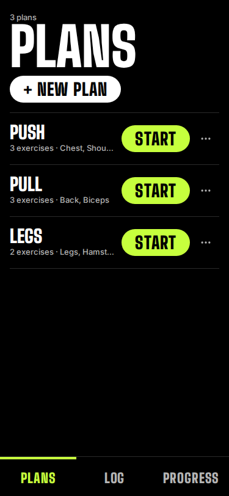
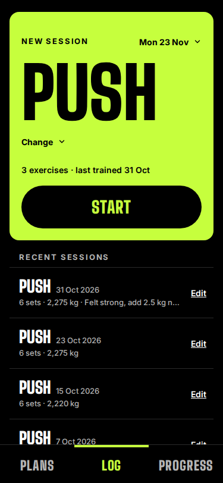
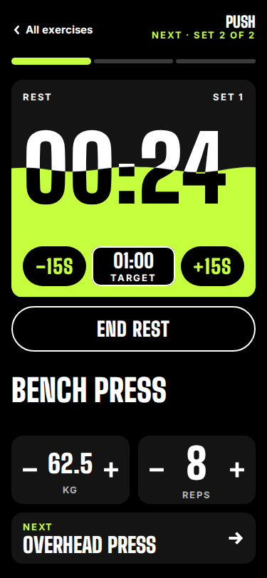
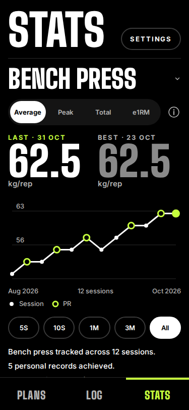

# GymOS

A phone-first gym tracker for logging a set and running a rest timer in a few taps, one-handed, between sets. No account, no server: your training data stays in the browser and moves in and out as CSV.

## Screenshots

| Plans | Log | Rest timer | Stats |
| --- | --- | --- | --- |
|  |  |  |  |

## Features

- **Training plans**: create plans of strength, calisthenics and cardio exercises each with a muscle group and how it is tracked (reps, optional weight, time, optional distance); open a plan's overview to see its exercises in order; edit a plan, with renamed exercises renamed in its past sessions too; archive, restore and delete them.
- **Session logging**: start a plan, log weight and reps with large steppers, or time a hold or a cardio effort with optional distance. Edit or delete a logged set, back-date a session, and edit or delete a saved one.
- **Rest and hold timers**: a rest starts when a set is logged and fills its timer block as it runs, its top edge a moving wave (flat with reduced motion), with buttons to add or take off time and to skip. A sound and vibration cue plays at the end. Timers survive switching exercises and reloading the page.
- **Finish screen**: totals for the session, notes, then save. A newly saved session is first in Recent on the Log home.
- **Session history**: Recent on the Log home shows the six newest sessions; Show more reaches older ones ten at a time, and a filter button picks one plan to narrow the list to, archived or deleted plans included.
- **Stats**: per-exercise chart of average, peak, total or estimated one-rep max (e1RM), over the last 5 or 10 sessions, 1 or 3 months, or all time, with last and best figures, a dot for every session and personal records ringed; an info button says what each metric measures.
- **CSV import and export**: export everything to one file, in the units you chose; import a file, review what was found, then add it to your data or replace your data. A file that can't be read changes nothing. Delete all data clears plans and sessions after a confirmation and keeps your preferences.
- **kg or lb, km or mi**: pick units in Settings and every screen, figure and export follows; the stored values are never rewritten by the choice.
- **Accent colour**: choose lime, amber, cyan, violet or red in Settings; rest, the main button and the active tab follow it, and every option keeps black text on it readable.
- **Installable**: a web manifest lets the app be added to a home screen, and the two typefaces are bundled, so no request leaves the app's origin. A service worker caches the build, so after a first visit the app reloads with no network.

## Stack

React 19 and TypeScript, built with Vite. Recharts draws the Stats chart. Data lives in `localStorage`. Vitest covers the logic, and Playwright drives the built app in a mobile Chromium profile, with axe checking accessibility.

## Engineering highlights

- **Timers that survive reloads.** A running timer is stored as a start time and a target rather than a counter, so it shows the right time after a reload or a backgrounded tab (`src/hooks/useTimer.ts`; reload tests in `tests/e2e/session-list.spec.ts` and `tests/e2e/timed-set.spec.ts`).
- **Unfinished work never leaks.** An in-progress session is kept under its own storage key and only joins the saved sessions on Save, so Stats and the CSV export see finished sessions only (`src/utils/activeSession.ts`).
- **A refused save on Finish or New plan is not silent.** If the browser refuses the write, the screen stays open with a Not saved alert and Try again, and Finish offers the session as a CSV download (`tests/e2e/save-failed.spec.ts`).
- **Import is reviewed before it writes.** The file is parsed and summarised first; nothing is stored until the user picks Add to my data or Replace my data, and a bad file leaves the data untouched (`src/utils/csv.ts`, `src/utils/importData.ts`, `tests/e2e/data.spec.ts`).
- **Accessibility is tested, not assumed.** axe (WCAG 2.1 A and AA) runs on each screen and its main states in the end-to-end suite, and the shared controls have a 44 px minimum hit area.

## Run it

Requires Node.js 22.13+ (22.x) or 24+, and npm.

```bash
npm ci
npm run dev
```

| Command | What it does |
| --- | --- |
| `npm run build` | Type-check and build static files into `dist/` |
| `npm run preview` | Serve the built app |
| `npm run lint` | ESLint |
| `npx tsc -b` | Type-check only |
| `npm test` | Unit tests (Vitest) |
| `npx playwright install chromium webkit` | One-time browser install for the end-to-end tests (WebKit on Linux may also need `sudo npx playwright install-deps webkit`) |
| `npm run test:e2e` | End-to-end and accessibility tests against the built app on port 4173 (set `E2E_PORT` to change it) |

## Documentation

- [Architecture](docs/ARCHITECTURE.md): how the app is put together, where data lives, trust boundaries, failure behaviour and testing.
- [Third-party notices](THIRD_PARTY_NOTICES.md): bundled fonts and their licences.

## Licence and credits

No licence has been chosen yet, so all rights are reserved. Inter and Big Shoulders Display are used under the SIL Open Font License 1.1; see the notices.
